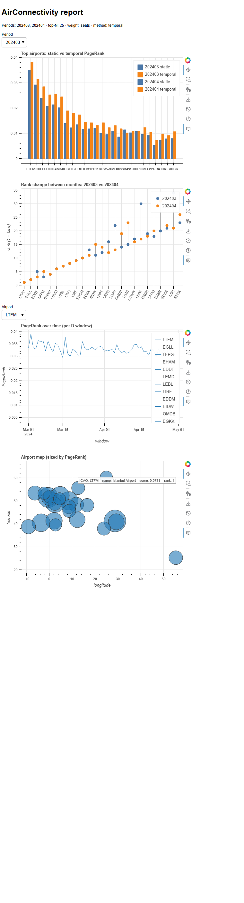
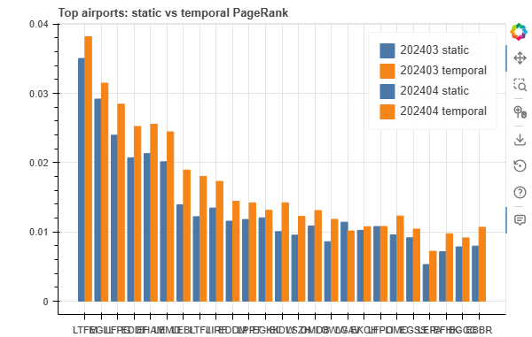
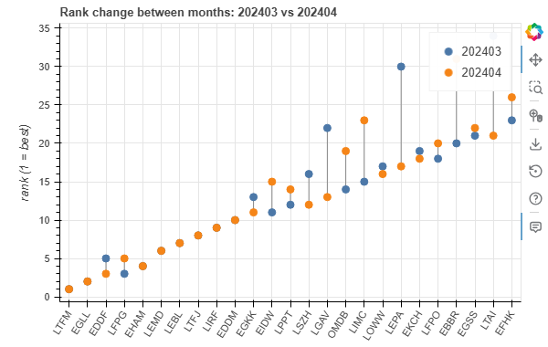
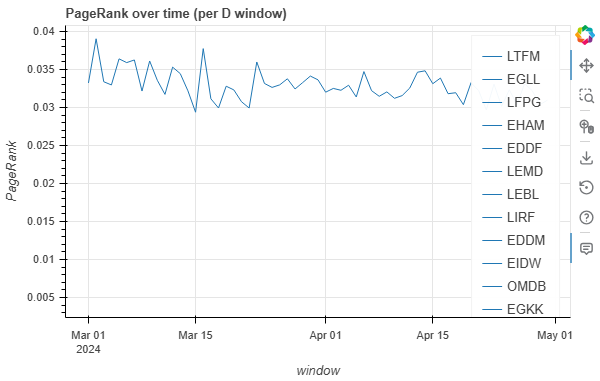
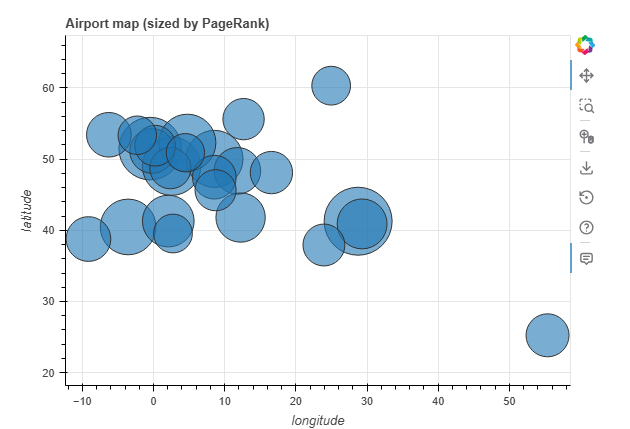
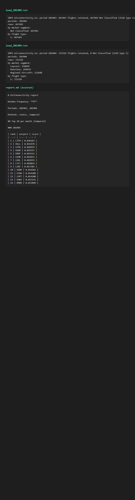

# AirConnectivity — PageRank air connectivity indicator

Analyse EUROCONTROL R&D flight data as a directed airport network and rank
airports by **static** weighted PageRank and by **temporal** PageRank
(Rozenshtein & Gionis, 2016), where walks follow only feasible connections that
respect a minimum connecting time (MCT).

The package installs an `airconn` CLI that loads the gzipped EUROCONTROL
exports in place, builds per-window graphs, ranks airports and writes CSV,
Markdown and interactive HTML reports.

> **Built by an agent swarm.** This repository is a proof of concept for [Swarmly](https://github.com/eeftychiou/swarmly): AI coding agents (Claude Code, OpenAI Codex CLI, Antigravity and a DeepSeek agent) worked through its issues and pull requests, coordinating through Swarmly, with a human maintainer in charge. It rebuilds and extends the author's earlier [AirConnectivity](https://github.com/eeftychiou/AirConnectivity) indicator (2021).

All outputs are **aggregated airport-level results**; raw flight rows are never
written and no data is committed to the repository.

## Screenshots

The report below was generated from a real two-period run:

```bash
DATA="/path/to/eurocontrol-rnd-data"
airconn rank --data-root "$DATA" --periods 202403,202404 \
    --window M --weight seats --method both --out outputs
airconn report --data-root "$DATA" --rankings outputs --periods 202403 202404 \
    --html outputs/report.html --inline --top-n 25
```

It is a single page with a period selector over both months. See
[`docs/usage.md`](docs/usage.md) for the exact commands.

| | |
| --- | --- |
| **Full interactive HTML report** (`airconn report --html`) | **Static vs temporal PageRank** per period |
|  |  |
| **Rank change between months** (dumbbell) | **One airport's PageRank over time** (daily windows) |
|  |  |
| **Airport map** sized by PageRank — the callout reproduces the map's hover tooltip for the top airport | **CLI summary and Markdown report excerpt** |
|  |  |

The map chart has a hover tooltip per airport (ICAO, name, score, rank). The
screenshot above captions the tooltip for the top airport as a callout, since a
headless capture cannot reproduce a live pointer hover.

## Install

Python >= 3.10.

```bash
python -m venv .venv
# Windows: .venv\Scripts\activate ; POSIX: source .venv/bin/activate
pip install -e .            # core: numpy, pandas, networkx, scipy
pip install -e ".[viz]"     # + bokeh, for the interactive HTML report
pip install -e ".[dev]"     # + pytest, ruff, bokeh (development)
```

## Data layout

Point `--data-root` (or `AIRCONN_DATA_ROOT`) at a directory of period folders
holding the EUROCONTROL exports:

```
<data-root>/
  202403/
    Flights_20240301_20240331.csv.gz
  202404/
    Flights_20240401_20240430.csv.gz
  ...
```

Folders are `YYYYMM`. The 2020–2023 folders are **quarterly** (03/06/09/12);
2024–2025 are mostly monthly. The loader reads only `Flights_*.csv.gz`
(recursively, since some exports nest one level deeper) and ignores everything
else. Data can be downloaded from the
[EUROCONTROL R&D Data Archive](https://www.eurocontrol.int/dashboard/rnd-data-archive).

## Quickstart

```bash
DATA="/path/to/eurocontrol-rnd-data"

# 1. Load a period and print aggregate counts (no row-level data).
airconn load --data-root "$DATA" --period 202403 --summary

# 2. Write per-period airport rankings as CSV.
airconn rank --data-root "$DATA" --periods 202403,202404 \
    --window M --weight seats --method both --out outputs

# 3. Build the Markdown month-comparison report.
airconn report --rankings outputs --out outputs/report.md

# 4. Build the interactive HTML report (self-contained; --inline works offline).
airconn report --data-root "$DATA" --rankings outputs --periods 202403 202404 \
    --html outputs/report.html --inline --top-n 25
```

See [`docs/usage.md`](docs/usage.md) for every command and option, the default
passenger filter, the weight modes, MCT/max-wait, the output CSV columns and how
the seat and airport-name lookups are sourced.

## Package layout

```
src/airconnectivity/
  config.py       explicit Config dataclass (replaces the old settings module)
  geo.py          great-circle distance and flight-time estimates
  io.py           period discovery + EUROCONTROL flight-file loaders
  weights.py      edge weighting (frequency, unweighted, distance, seats)
  graphs.py       time-windowed graphs (daily/weekly/monthly) + static PageRank
  temporal.py     MCT/respecting connections + temporal PageRank
  report.py       ranking CSVs and the Markdown report
  report_html.py  the interactive bokeh HTML report
  cli.py          the `airconn` command-line entry point
  data/           committed lookups: ICAO aircraft seats, ICAO airport names
tests/            pytest suite (small synthetic fixtures only)
docs/             usage guide and screenshots
scripts/          make_screenshots.py (regenerate docs/img)
```

## Development

```bash
pip install -e ".[dev]"
ruff check .
pytest
```

CI runs ruff and pytest on Python 3.10 and 3.12.
